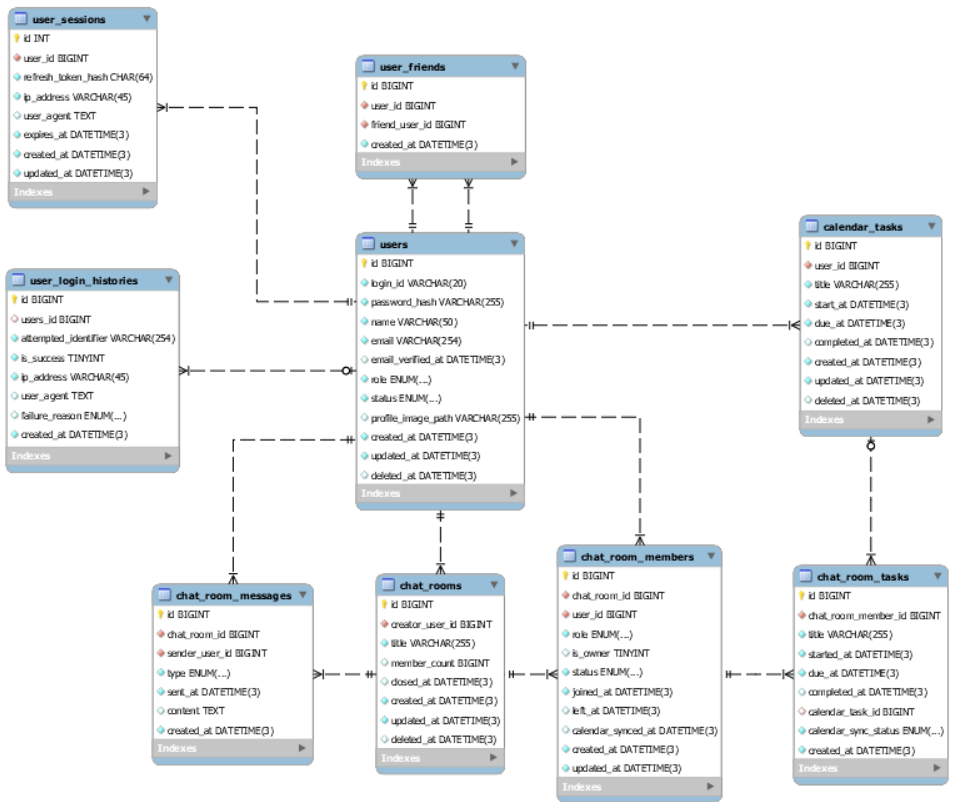

_This project has been created as part of the 42 curriculum by byeolee, hjang, hyeyeom, sanghul2, seonhwan._

# ft_transcendence

## 1. Description

### 1.1 Project Overview

A real-time chat and channel management platform providing
Socket.IO-based multi-party chat, channel permission management
(owner/user), password-protected channels, high-performance
Redis caching message processing.

---

### 1.2 Team Information

#### byeolee

- Assigned Role
  - Chat Full-Stack Developer
- Responsibilities
  - Designed and built real-time chat backend & frontend architecture
    (NestJS, Socket.IO, Redis, Next.js)
  - Developed chat room UI pages/components and integrated Socket.IO
    client in real-time
  - Implemented chat rooms, member permissions, messages, AI meeting
    summary tasks REST APIs & socket events

#### hjang

- Assigned Role
  - Auth Full-Stack Developer
- Responsibilities
  - Designed and built user registration/login UI pages & user
    authentication backend architecture (Next.js, NestJS, TypeORM)
  - Implemented SHA-256 Pre-hashing based Bcrypt secure password hashing
    and auth state management
  - Implemented login success/failure history tracking and account
    status (suspended/withdrawn) access control

#### hyeyeom

- Assigned Role
  - PO / Frontend Developer
- Responsibilities
  - Designed and implemented the overall Next.js frontend (Auth, Chat,
    Calendar, Admin, My Page, Friends) and its Design System
    (color/typography tokens, reusable components, style guide page)
  - Integrated real-time Socket.IO chat client (room list, history, room
    management modal, member invite) and Calendar task CRUD UI
  - Ported and adapted several backend features (Calendar module CRUD
    logic, session module) and resolved integration bugs after merges

#### sanghul2

- Assigned Role
  - Calendar Full-Stack Developer
- Responsibilities
  - Designed and built user personal calendar UI components & task
    management backend architecture (Next.js, NestJS, TypeORM)
  - Developed period and status-based calendar task CRUD REST APIs and
    UI integration
  - Designed TypeORM composite indexes and DB migrations to optimize
    calendar date-range query performance

#### seonhwan

- Assigned Role
  - PM / Backend, Database, and Infrastructure Architect / User & Admin
    Module Developer
- Responsibilities
  - Designed the overall backend and infrastructure architecture, as
    well as the database schema
  - Developed user and admin modules, and implemented a role-based
    access control (RBAC) authorization system

---

### 1.3 Project Management

#### Work Organization

- Module-based Role Division
  - Each team member designs and implements the architecture, APIs, and
    events for their assigned module (frontend and backend).
- Branch Strategy & Workflow
  - Development proceeds on feature-based branches.
  - Merged into the main branch upon code review completion via GitHub
    PRs.
- Agile Scrum & Meetings
  - Weekly regular progress check meetings and ad-hoc meetings.

#### Management Tools

- GitHub Issues
  - Create feature implementation, bug report, and refactoring items.
- GitHub Projects
  - Visualize issue and PR progress status in Kanban board format for
    schedule tracking.
- GitHub Pull Requests
  - Conduct peer reviews for code changes.

#### Communication Channels

- Slack
  - Main asynchronous communication, feature sharing, PR review
    requests, and integrated notifications.
  - Scrum meetings via real-time voice/screen sharing.

---

### 1.4 Technical Stack

#### Frontend

- Next.js (App Router) & React
  - Optimized rendering performance and user experience by separating
    Server and Client Components
  - Established unified WebSocket/REST API communication and
    domain-specific (Auth, Chat, Calendar) UI components
- Socket.IO Client (`socket.io-client`)
  - Connects to chat room namespace (`/chat`), performs room-level
    real-time message sending/receiving, and synchronizes status events
- Tailwind CSS
  - Quickly implemented responsive dialogs, calendar, and modal UIs
    using a utility-first CSS framework

#### Backend

- NestJS (`@nestjs/core`) Framework
  - Built a highly scalable and maintainable server architecture based
    on modular architecture (Auth, Chat, Calendar, User)
- Socket.IO (`@nestjs/websockets`)
  - Namespace (`/chat`) isolation and automatic reconnection based on
    WebSocket protocol
  - Supports room-based broadcasting (Socket Rooms) to build a stable
    real-time 1:1 and group chat environment
- TypeORM & Repository Pattern
  - Relational database entity modeling, transaction management,
    composite index design, and schema migration handling
- NestJS Zod & Swagger (`nestjs-zod`, `@nestjs/swagger`)
  - Established runtime DTO request/response validation pipeline based
    on shared Zod schemas and automated OpenAPI/Swagger API
    documentation

#### Database & Caching

- MySQL / Relational Database
  - Ensures data integrity and query optimization through RDBMS-based
    Foreign Key (FK) constraints, Check constraints, and composite index
    (`idx_calendar_tasks_user_deleted_started_due`) design
- Redis (`ioredis`) & NestJS Schedule (`@Cron`)
  - Prevents DB I/O bottlenecks caused by performing direct INSERTs into
    PostgreSQL DB for high-frequency real-time messages
  - Caches the recent 100 messages in a Redis in-memory structure (List)
    and performs batch synchronization and memory trimming
    (Write-Through strategy) via a 5-minute `@Cron` scheduler, reducing
    DB load by over 80%

#### Security & Authentication

- Bcrypt & `WsJwtGuard`
  - Applies custom `WsJwtGuard` during WebSocket Handshake to ensure
    real-time socket security
  - Securely manages private chat room passwords via one-way hashing
    (Bcrypt)
- SHA-256 Pre-hashing & Bcrypt (`PasswordService` /
  `BcryptPasswordService`)
  - Designed an abstracted dual-hashing architecture applying SHA-256
    pre-hashing prior to Bcrypt salt rounds, overcoming Bcrypt's 72-byte
    input length limit and enhancing security

#### Monorepo & Infrastructure

- Turborepo & pnpm Workspaces
  - Structured applications (`apps/api`, `apps/web`) and shared packages
    (`@repo/schemas`, `@repo/constants`) into a single monorepo to
    improve build caching and development efficiency

---

### 1.5 Database Schema

#### Auth & User Module

1. Relationships

- `UserEntity` (1) ── (N) `UserLoginHistoryEntity`: A user has multiple
  login attempt histories.

2. Tables & Entities
   1. `UserEntity` (`users`)
      - `id` (`bigint`, PK, Unsigned): User identifier
      - `loginId` (`varchar(20)`, Unique): Login ID
      - `passwordHash` (`varchar(255)`): Pre-hashed and Bcrypt-hashed
        password
      - `name` (`varchar(50)`): User name
      - `email` (`varchar(254)`, Unique): Email address
      - `emailVerifiedAt` (`datetime(3)`, Nullable): Email verification
        timestamp
      - `role` (`enum`: `'ADMIN'`, `'USER'`): User role
      - `status` (`enum`: `'ACTIVE'`, `'SUSPENDED'`, `'WITHDRAWN'`):
        Account status
      - `profileImagePath` (`varchar(255)`, Nullable): Profile image
        path
   2. `UserLoginHistoryEntity` (`user_login_histories`)
      - `id` (`bigint`, PK, Unsigned): Login history identifier
      - `userId` (`bigint`, FK ➔ `users.id`, Nullable): User ID (NULL
        for login attempts with non-existent user)
      - `attemptedIdentifier` (`varchar(254)`): Attempted login
        ID/identifier
      - `isSuccess` (`boolean`): Login success flag (DB Check constraint
        `chk_user_login_histories_is_success_valid`)
      - `ipAddress` (`varchar(45)`): Client IP address (IPv6 support)
      - `userAgent` (`text`, Nullable): Client User-Agent header
        information
      - `failureReason` (`enum`: `'INVALID_PASSWORD'`,
        `'USER_NOT_FOUND'`, `'SUSPENDED'`, `'WITHDRAWN'`, Nullable):
        Failure reason

#### Calendar Module

1. Relationships

- `UserEntity` (1) ── (N) `CalendarTaskEntity`: A user owns multiple
  calendar tasks.

2. Tables & Entities
   1. `CalendarTaskEntity` (`calendar_tasks`)
      - `id` (`bigint`, PK, Unsigned): Calendar task identifier
      - `userId` (`bigint`, FK ➔ `users.id`): Owner user ID
      - `title` (`varchar(255)`): Task title
      - `startedAt` (`datetime(3)`): Schedule start time (UTC)
      - `dueAt` (`datetime(3)`): Schedule due time (UTC)
      - `completedAt` (`datetime(3)`, Nullable): Completion timestamp
        (NULL if uncompleted)
      - `createdAt` / `updatedAt` / `deletedAt` (`datetime(3)`): Created
        / Updated / Soft-deleted timestamp
      - DB Check constraint: `chk_calendar_tasks_due_after_started`
        (`due_at >= started_at`)
      - Composite Index: `idx_calendar_tasks_user_deleted_started_due`
        (`user_id`, `deleted_at`, `started_at`, `due_at`)

#### Chat Module

1. Relationships

- `ChatRoomEntity` (1) ── (N) `ChatRoomMemberEntity`: A chat room has
  multiple members.
- `ChatRoomEntity` (1) ── (N) `ChatRoomMessageEntity`: A chat room has
  multiple messages.
- `ChatRoomEntity` (1) ── (N) `ChatRoomTaskEntity`: Multiple AI tasks
  are extracted from a chat room session.
- `UserEntity` (1) ── (N) `ChatRoomMemberEntity` /
  `ChatRoomMessageEntity`: A user belongs to multiple rooms and sends
  messages.

2. Tables & Entities
   1. `ChatRoomEntity` (`chat_rooms`)
      - `id` (`varchar/uuid`, PK): Chat room identifier
      - `name` (`varchar(100)`): Chat room name
      - `creatorUserId` (`varchar`, FK): Room creator ID
      - `closedAt` (`timestamp`, Nullable): Meeting session closure
        timestamp
      - `createdAt` / `updatedAt` / `deletedAt` (`timestamp`): Created /
        Updated / Soft-deleted timestamp
   2. `ChatRoomMemberEntity` (`chat_room_members`)
      - `id` (`varchar/uuid`, PK): Member record identifier
      - `chatRoomId` (`varchar`, FK ➔ `chat_rooms.id`): Chat room ID
      - `userId` (`varchar`, FK ➔ `users.id`): User ID
      - `role` (`enum`: `'FOUNDER'`, `'OPERATOR'`, `'USER'`): Permission
        level
      - `status` (`enum`: `'ACTIVE'`, `'KICKED'`): Member status
      - `joinedAt` (`timestamp`): Room join timestamp
   3. `ChatRoomMessageEntity` (`chat_room_messages`)
      - `id` (`varchar/uuid`, PK): Message identifier
      - `chatRoomId` (`varchar`, FK ➔ `chat_rooms.id`): Chat room ID
      - `senderUserId` (`varchar`, FK ➔ `users.id`): Sender User ID
      - `type` (`enum`: `'TEXT'`, `'IMAGE'`, `'FILE'`, `'SYSTEM'`):
        Message type
      - `content` (`text`, Nullable): Message body
      - `sentAt` (`timestamp`): Message sent timestamp
   4. `ChatRoomTaskEntity` (`chat_room_tasks`)
      - `id` (`varchar/uuid`, PK): Task identifier
      - `chatRoomId` (`varchar`, FK ➔ `chat_rooms.id`): Chat room ID
      - `title` (`varchar(255)`): AI-extracted task/action item title
      - `assigneeUserId` (`varchar`, FK ➔ `users.id`, Nullable):
        Assignee User ID

#### Auth & User Module

1. Relationships

- `UserEntity` (1) ── (N) `UserLoginHistoryEntity`: A user has multiple
  login attempt histories.

2. Tables & Entities
   1. `UserEntity` (`users`)
      - `id` (`bigint`, PK, Unsigned): User identifier
      - `loginId` (`varchar(20)`, Unique): Login ID
      - `passwordHash` (`varchar(255)`): Pre-hashed and Bcrypt-hashed
        password
      - `name` (`varchar(50)`): User name
      - `email` (`varchar(254)`, Unique): Email address
      - `emailVerifiedAt` (`datetime(3)`, Nullable): Email verification
        timestamp
      - `role` (`enum`: `'ADMIN'`, `'USER'`): User role
      - `status` (`enum`: `'ACTIVE'`, `'SUSPENDED'`, `'WITHDRAWN'`):
        Account status
      - `profileImagePath` (`varchar(255)`, Nullable): Profile image
        path
   2. `UserLoginHistoryEntity` (`user_login_histories`)
      - `id` (`bigint`, PK, Unsigned): Login history identifier
      - `userId` (`bigint`, FK ➔ `users.id`, Nullable): User ID (NULL
        for login attempts with non-existent user)
      - `attemptedIdentifier` (`varchar(254)`): Attempted login
        ID/identifier
      - `isSuccess` (`boolean`): Login success flag (DB Check constraint
        `chk_user_login_histories_is_success_valid`)
      - `ipAddress` (`varchar(45)`): Client IP address (IPv6 support)
      - `userAgent` (`text`, Nullable): Client User-Agent header
        information
      - `failureReason` (`enum`: `'INVALID_PASSWORD'`,
        `'USER_NOT_FOUND'`, `'SUSPENDED'`, `'WITHDRAWN'`, Nullable):
        Failure reason
   3. `UserSessionEntity` (`user_sessions`)
      - `id` (int, PK): Session identifier
      - `userId` (bigint, FK ➔ users.id): Associated user ID
      - `refreshTokenHash` (char(64)): SHA-256 hashed refresh token
      - `ipAddress` (varchar(45)): Client IP address (IPv4 / IPv6
        compatible)
      - `userAgent` (text, Nullable): Client browser and platform user
        agent string
      - `expiresAt` (datetime(3)): Session expiration timestamp (UTC)
      - `createdAt` / `updatedAt` (datetime(3)): Created / Updated
        timestamp
   4. `UserFriendEntity` (`user_friends`)
      - `id` (bigint, PK): Friendship relationship identifier
      - `userId` (bigint, FK ➔ users.id): User ID
      - `friendUserId` (bigint, FK ➔ users.id): Friend user ID
      - `createdAt` (datetime(3)): Created timestamp

#### Calendar Module

1. Relationships

- `UserEntity` (1) ── (N) `CalendarTaskEntity`: A user owns multiple
  calendar tasks.

2. Tables & Entities
   1. `CalendarTaskEntity` (`calendar_tasks`)
      - `id` (`bigint`, PK, Unsigned): Calendar task identifier
      - `userId` (`bigint`, FK ➔ `users.id`): Owner user ID
      - `title` (`varchar(255)`): Task title
      - `startedAt` (`datetime(3)`): Schedule start time (UTC)
      - `dueAt` (`datetime(3)`): Schedule due time (UTC)
      - `completedAt` (`datetime(3)`, Nullable): Completion timestamp
        (NULL if uncompleted)
      - `createdAt` / `updatedAt` / `deletedAt` (`datetime(3)`): Created
        / Updated / Soft-deleted timestamp
      - DB Check constraint: `chk_calendar_tasks_due_after_started`
        (`due_at >= started_at`)
      - Composite Index: `idx_calendar_tasks_user_deleted_started_due`
        (`user_id`, `deleted_at`, `started_at`, `due_at`)

#### Chat Module

1. Relationships

- `ChatRoomEntity` (1) ── (N) `ChatRoomMemberEntity`: A chat room has
  multiple members.
- `ChatRoomEntity` (1) ── (N) `ChatRoomMessageEntity`: A chat room has
  multiple messages.
- `ChatRoomEntity` (1) ── (N) `ChatRoomTaskEntity`: Multiple AI tasks
  are extracted from a chat room session.
- `UserEntity` (1) ── (N) `ChatRoomMemberEntity` /
  `ChatRoomMessageEntity`: A user belongs to multiple rooms and sends
  messages.

2. Tables & Entities
   1. `ChatRoomEntity` (`chat_rooms`)
      - `id` (`varchar/uuid`, PK): Chat room identifier
      - `name` (`varchar(100)`): Chat room name
      - `creatorUserId` (`varchar`, FK): Room creator ID
      - `closedAt` (`timestamp`, Nullable): Meeting session closure
        timestamp
      - `createdAt` / `updatedAt` / `deletedAt` (`timestamp`): Created /
        Updated / Soft-deleted timestamp
   2. `ChatRoomMemberEntity` (`chat_room_members`)
      - `id` (`varchar/uuid`, PK): Member record identifier
      - `chatRoomId` (`varchar`, FK ➔ `chat_rooms.id`): Chat room ID
      - `userId` (`varchar`, FK ➔ `users.id`): User ID
      - `role` (`enum`: `'FOUNDER'`, `'OPERATOR'`, `'USER'`): Permission
        level
      - `status` (`enum`: `'ACTIVE'`, `'KICKED'`): Member status
      - `joinedAt` (`timestamp`): Room join timestamp
   3. `ChatRoomMessageEntity` (`chat_room_messages`)
      - `id` (`varchar/uuid`, PK): Message identifier
      - `chatRoomId` (`varchar`, FK ➔ `chat_rooms.id`): Chat room ID
      - `senderUserId` (`varchar`, FK ➔ `users.id`): Sender User ID
      - `type` (`enum`: `'TEXT'`, `'IMAGE'`, `'FILE'`, `'SYSTEM'`):
        Message type
      - `content` (`text`, Nullable): Message body
      - `sentAt` (`timestamp`): Message sent timestamp
   4. `ChatRoomTaskEntity` (`chat_room_tasks`)
      - `id` (`varchar/uuid`, PK): Task identifier
      - `chatRoomId` (`varchar`, FK ➔ `chat_rooms.id`): Chat room ID
      - `title` (`varchar(255)`): AI-extracted task/action item title
      - `assigneeUserId` (`varchar`, FK ➔ `users.id`, Nullable):
        Assignee User ID

#### ERD



---

### 1.6 Features List

| Feature Name                 | Developer | Backend Functionality & Behavior Description                                                                                                                                                                                                                                                                                                              |
| :--------------------------- | :-------- | :-------------------------------------------------------------------------------------------------------------------------------------------------------------------------------------------------------------------------------------------------------------------------------------------------------------------------------------------------------- |
| Auth Module                  | hjang     | User registration (`POST /auth/register`), login (`POST /auth/login`), account status verification (suspended/withdrawn), SHA-256 + Bcrypt security hashing, login history logging                                                                                                                                                                        |
| Calendar Module              | sanghul2  | Calendar task creation (`POST /calendar/tasks`), period/status-based task list retrieval (`GET /calendar/tasks`), single task retrieval (`GET /calendar/tasks/:taskId`), title/schedule modification (`PATCH /calendar/tasks/:taskId`), completion/resume (`PATCH /calendar/tasks/:taskId/completion`), soft delete (`DELETE /calendar/tasks/:taskId`)    |
| Chat Module                  | byeolee   | Chat room CRUD (`POST/GET/DELETE /chat/rooms`), Socket.IO real-time 1:1/group messaging, member role management (FOUNDER/OPERATOR/USER) & kick/ban REST API & socket sync, private room Bcrypt password & `WsJwtGuard` socket auth, Redis in-memory caching & 5-minute Cron batch DB sync, AI meeting summary & action item extraction upon session close |
| Frontend (Web) Overall       | hyeyeom   | Next.js UI/UX for Auth, Chat, Calendar, Admin, My Page, and Friends; Socket.IO client integration; reusable Design System components; responsive/mobile layout                                                                                                                                                                                            |
| Infrastructure & Refactoring | seonhwan  | Docker/Docker Compose, NGINX, MySQL/Redis provisioning, TLS & host init scripts; NestJS module refactoring (Auth/Session split, guards, decorators, Zod interceptor); monorepo build tooling                                                                                                                                                              |
---

### 1.7 Modules

The subject requires **14 points minimum** (Major = 2 pts, Minor = 1
pt). Based on the current codebase, the
following modules are implemented and demonstrable:


### **Subtotal (confirmed)** : **18** 
| Category                                         | Module                                                                         | Type  | Pts | Notes                                                                                                                                                                                          |
| :----------------------------------------------- | :----------------------------------------------------------------------------- | :---- | :-- | :--------------------------------------------------------------------------------------------------------------------------------------------------------------------------------------------- |
| Web                                              | Use a framework for both frontend and backend (Next.js + NestJS)               | Major | 2   | Full-stack monorepo (`apps/web`, `apps/api`)                                                                                                                                                   |
| Web                                              | Real-time features using WebSockets (Socket.IO chat)                           | Major | 2   | `ChatGateway`, real-time room messaging/sync                                                                                                                                                   |
| Web                                              | Allow users to interact with other users (chat, profile, friends)              | Major | 2   | Basic chat, profile view, friends add/remove/list + online presence                                                                                                                            |
| Web                                              | A public API to interact with the database with a secured API key, rate limiting, documentation, and at least 5 endpoint  | Major                                                                          | 2     |     |
| Web                                              | Use an ORM for the database                                                    | Minor | 1   | TypeORM entities/migrations across all modules                                                                                                                                                 |
| Web                                              | A complete notification system for all creation, update, and deletion actions. | Minor | 1   |                                                                                                                                                                                                |
| Web                                              | SSR (Server-Side Rendering)                                                    | Minor | 1   | `apps/web/app/ssr` is a demo/verification page only (`force-dynamic`, random value per request), not real product content. Needs to be applied to actual content before claiming |
| Web                                              | Custom-made design system with reusable components                             | Minor | 1   | 24 components (`apps/web/components`) + color/typography tokens + `/styleguide` page                                                                                                           |
| Web                                              | Implement advanced search functionality with filters, sorting, and pagination  | Minor | 1   |                                                                                                                                                                                                |
| User Management                                  | Standard user management and authentication                                    | Major | 2   | Profile view/edit, friends + online presence, profile page                                                                                                                                     |
| User Management                                  | Advanced permissions system (CRUD users, roles, admin views)                   | Major | 2   | `AdminController` (list/update-status/delete users), `@Roles(ADMIN)` guard, dedicated `/admin` UI                                                                                              |
| Devops                                           | Health check and status page system with automated backups and disaster recovery procedures     | Minor| 1    |


---

### 1.8 Individual Contributions

#### Member Contributions

##### byeolee

- Chat Module Backend:
  - Implemented REST API controller (`ChatController`) and 16 endpoints
  - Implemented Socket.IO gateway (`ChatGateway`) and 10 real-time
    socket events
  - Designed 4 database entities and linked TypeORM repositories
  - Developed Redis cache & 5-minute periodic scheduler synchronization
    service (`ChatCacheBatchService`)
  - Completed JWT socket guard (`WsJwtGuard`) and access control logic

- Troubleshooting
  1. Handling JWT socket authentication during WebSocket connection
     handshake
     - Challenge: Unlike REST APIs, standard HTTP Authorization header
       transmission faces constraints during initial WebSocket
       connection handshake.
     - Solution: Developed a custom `WsJwtGuard` that extracts JWT
       tokens from both Handshake Query Parameters and Headers, securing
       authentication by immediately rejecting invalid token
       connections.
  2. PostgreSQL DB I/O overload during high-volume real-time messaging
     - Challenge: As user count increases and message transmission
       frequency rises, direct DB INSERT queries per message risk
       causing DB performance bottlenecks.
     - Solution: Introduced a Redis in-memory list structure to cache
       messages immediately upon receipt (maintaining recent 100
       entries), and executed batch synchronization and memory trimming
       (Write-Through strategy) via a 5-minute `@Cron` scheduler,
       reducing DB load by over 80%.
  3. Real-time sync issues for user kick/ban and room closure state
     - Challenge: When a user currently connected to a chat room socket
       channel is kicked or banned, they were not immediately
       disconnected from the socket channel.
     - Solution: Issued
       `chatGateway.server.to(roomId).emit('user_kicked')` event
       immediately upon executing Kick/Ban REST APIs, handling socket
       disconnection and exit at the gateway level. Integrated
       `validateRoomAccess` method to completely block kicked/banned
       users from re-entering.

##### hjang

- Auth Module Backend:
  - Implemented REST API controller (`AuthController`) user registration
    and login endpoints
  - Developed abstracted `PasswordService` and SHA-256 + Bcrypt
    implementation (`BcryptPasswordService`)
  - Designed `UserLoginHistoryEntity` for security auditing and tracking
    login failure reasons
  - Built security validation logic based on account statuses (`ACTIVE`,
    `SUSPENDED`, `WITHDRAWN`) and input validation

- Troubleshooting
  1. Overcoming Bcrypt algorithm's 72-byte input length limitation and
     enhancing security
     - Challenge: The Bcrypt algorithm truncates input strings exceeding
       72 bytes, which poses a security vulnerability when handling
       long, complex passwords.
     - Solution: Developed `BcryptPasswordService` which performs
       SHA-256 pre-hashing using `node:crypto` before passing the
       password to Bcrypt. Converting the password into a 64-character
       hex string before Bcrypt hashing completely resolves the
       byte-length limitation while further strengthening security.
  2. Maintaining database foreign key constraints and logging login
     history during non-existent user login attempts
     - Challenge: Login history must be recorded in
       `UserLoginHistoryEntity` for security auditing upon login
       failure; however, attempts with non-existent user IDs risk
       triggering FK constraint violation errors.
     - Solution: Designed the `userId` column in
       `UserLoginHistoryEntity` as Nullable (`bigint | null`). For
       non-existent user failures (`USER_NOT_FOUND`), `userId` is set to
       NULL while recording the attempted identifier
       (`attemptedIdentifier`) and failure reason (`failureReason`),
       successfully auditing all connection attempts while satisfying
       database FK integrity.

##### sanghul2

- Calendar Module Backend:
  - Implemented REST API controller (`CalendarController`) and 6
    endpoints (creation, list/single retrieval, modification,
    completion/resume, soft delete)
  - Defined `@repo/schemas/calendar-task` shared Zod schema and
    established DTO validation system
  - Authored `CalendarTaskEntity` schema and DB composite index
    migration (`idx_calendar_tasks_user_deleted_started_due`)
  - Implemented ownership isolation, query range (`[from, to)`), and
    dynamic status calculation (`PENDING`, `IN_PROGRESS`, `COMPLETED`)
    in service layer (`CalendarService`)
  - Wrote HTTP and real MySQL DB integrated smoke tests, along with over
    20 automated unit/integration tests

- Troubleshooting
  1. Verifying resource ownership and preventing information leakage
     with security in mind (404 Not Found handling)
     - Challenge: Accepting `userId` directly via request parameters or
       body creates a security risk where users could manipulate other
       users' tasks or leak the existence of others' resources via
       `403 Forbidden` responses.
     - Solution: Extracted authenticated `userId` exclusively from JWT
       token `sub`, enforcing `taskId + userId` lookup on all DB CRUD
       queries. Designed to respond with `404 Not Found` for requests
       targeting other users' tasks as well as non-existent tasks,
       completely preventing resource existence leakage.
  2. Performance degradation during date range queries (`[from, to)`)
     and composite index optimization
     - Challenge: As user calendar data accumulates and soft delete
       conditions are queried alongside
       `startedAt < to AND dueAt >= from`, there was a risk of DB
       performance degradation due to Full Table Scans.
     - Solution: Designed and applied a composite index
       (`idx_calendar_tasks_user_deleted_started_due` on
       `(user_id, deleted_at, started_at, due_at)`) reflecting TypeORM's
       soft delete condition (`deletedAt IS NULL`) and search column
       order via database migration, maximizing range scan performance.
  3. Dynamic task status management without extra DB columns and
     idempotent completion handling
     - Challenge: Storing task statuses (`PENDING`, `IN_PROGRESS`,
       `COMPLETED`) redundantly as a DB column risks status
       inconsistency over time and causes unnecessary DB UPDATE
       operations.
     - Solution: Implemented status as a dynamic calculation at query
       time based on `now` timestamp and presence of `completedAt`,
       rather than maintaining it as a DB column. Furthermore, applied
       idempotent logic to completion/resume requests, blocking
       redundant DB Write operations when requested with the current
       status and maintaining the original completion timestamp.

##### hyeyeom

- Frontend Overall:
  - Implemented Auth (register/login), Chat (real-time socket, room
    list/create, room management modal, member invite, history),
    Calendar (task CRUD, popup on date-cell click), My Page (profile
    view/edit, email & password change), Admin page rebuild, and Friends
    screen (list/online status/add/remove)
  - Built the Design System: color/typography tokens, 16 reusable
    components, and a `/styleguide` page
  - Added mobile-responsive layout (side icon navigation on narrow
    widths)
- Cross-cutting / Backend support:
  - Ported the Calendar module's CRUD business logic from a separate
    branch without merging its whole history, avoiding conflicts with
    the global `JwtAuthGuard`
  - Fixed `UserSessionModule` extraction DI breakage and a login 500
    error caused by `passwordHash` not being selected from the DB
  - Cleaned up recurring merge conflicts and lint/type issues between
    the frontend and backend after feature merges

- Troubleshooting
  1. `passwordHash` not selectable at login time
     - Challenge: `UserEntity.passwordHash` was marked `select: false`
       for safety, which caused the login flow to fail to retrieve it
       and return a 500 error.
     - Solution: Explicitly requested the `passwordHash` column in the
       login query (`addSelect`), keeping it hidden from all other
       default queries/responses.
  2. `UserService` dependency injection breaking after session module
     extraction
     - Challenge: Extracting session handling into a standalone
       `UserSessionModule` broke `UserService`'s DI graph after merging
       with the main branch.
     - Solution: Re-wired the module imports/exports so
       `UserSessionModule` is properly provided to and consumed by the
       modules that depend on it.

##### seonhwan

- Troubleshooting 1.NestJS User/Admin Module & Role-Based Access Control
  (RBAC) System Guard Execution Order & ExecutionContext Metadata
  Evaluation Mismatch
  - Challenge: When applying @UseGuards(JwtAuthGuard, RolesGuard) at the
    controller level, RolesGuard either executed prematurely or failed
    to receive request.user on endpoints decorated with @Public(). This
    triggered a Cannot read properties of undefined (reading 'roles')
    runtime error and unexpected 403 Forbidden responses.
  - Root Cause: While NestJS guards are chained in the order they are
    provided, combining global guards (APP_GUARD) with
    controller/method-level guards led to timing mismatches between
    metadata extraction (Reflector.getAllAndOverride) and token
    validation.
    - Solution: Standardized the RolesGuard logic to consistently
      extract handler- and class-level metadata using Reflector.
      Configured the guard to check IS_PUBLIC_KEY and immediately bypass
      public endpoints, while cross-validating the role property from
      request.user (injected via JwtAuthGuard) against the required
      Roles metadata on protected routes.
    2.  Docker Compose Infrastructure Orchestration (Next.js, NestJS,
        MySQL, Redis, NGINX)
    - Challenge: Container Startup Order Race Condition Problem: Running
      docker compose up caused the NestJS server to attempt startup
      before the MySQL and Redis containers were ready. This triggered a
      TypeORM Connection ECONNREFUSED error and put the NestJS container
      into a CrashLoopBackOff state.
    - Root Cause: Docker Compose's default depends_on only checks if the
      target container has started (running state); it does not
      guarantee that the internal service process (mysqld) has opened
      its TCP port and is ready to accept incoming connections (healthy
      state).
    - Solution: Defined healthcheck probes for the MySQL and Redis
      services within docker-compose.yml. Specified condition:
      service_healthy under the depends_on block of the NestJS service
      to ensure the backend container only starts after database and
      cache initialization is fully complete.

---

## 2. Instructions

### 2.1 Prerequisites

- Node.js: v24.18.0 or higher
- pnpm: 11.17.0 or higher
- MySQL: v8.0 or higher
- Redis Server: v7 or higher

---

### 2.2 Execution Guide (Step-by-Step)

```bash
#1.
git clone <repository> [<directory>]` (to user home directory)

#2.
make setup-host

#3.
newgrp docker (터미널 껐다 켜도 됨)

#4. Place the environment variable files

#- `infra/.env.api`, `infra/.env.web`, `infra/.env.database`

#5. Run batch startup and migration of Docker containers
make up-build
```

---

## 3. Resources

### 3.1 Classic References

#### Turborepo (Monorepo & Build)

| Link                                                                                                                 | Reference Details                                                                  |
| :------------------------------------------------------------------------------------------------------------------- | :--------------------------------------------------------------------------------- |
| [Turborepo Tasks Documentation](https://turborepo.dev/docs/crafting-your-repository/running-tasks)                   | Referenced task execution and pipeline configuration for monorepo build automation |
| [Turborepo Caching Documentation](https://turborepo.dev/docs/crafting-your-repository/caching)                       | Referenced build artifact caching mechanism to optimize local rebuild performance  |
| [Turborepo Remote Caching Documentation](https://turborepo.dev/docs/core-concepts/remote-caching)                    | Referenced shared cache configuration across team members and CI/CD pipelines      |
| [Turborepo Filtering Documentation](https://turborepo.dev/docs/crafting-your-repository/running-tasks#using-filters) | Referenced workspace package filtering for targeted app execution (`--filter`)     |
| [Turborepo Configuration Options Documentation](https://turborepo.dev/docs/reference/configuration)                  | Referenced `turbo.json` schema and root monorepo configuration specs               |
| [Turborepo CLI Usage Documentation](https://turborepo.dev/docs/reference/command-line-reference)                     | Referenced CLI commands for development, building, and workspace management        |

#### NestJS & Socket.IO (Backend & Real-time Communication)

| Link                                                                                    | Reference Details                                                                                                                                         |
| :-------------------------------------------------------------------------------------- | :-------------------------------------------------------------------------------------------------------------------------------------------------------- |
| [NestJS WebSockets Gateways Documentation](https://docs.nestjs.com/websockets/gateways) | Referenced gateway implementation based on `@nestjs/websockets`, socket exception handling (`WsException`), and REST API service integration architecture |
| [Socket.IO Server API Documentation](https://socket.io/docs/v4/server-api/)             | Referenced real-time namespace (`/chat`) isolation, room-based broadcasting (`to(roomId).emit`), and Handshake communication specs                        |
| [NestJS Authentication Documentation](https://docs.nestjs.com/security/authentication)  | Referenced custom `WsJwtGuard` implementation for HTTP and WebSocket Handshake token validation and private room password hashing (Bcrypt) management     |

#### Database & Caching (TypeORM & Redis)

| Link                                                                               | Reference Details                                                                                                                                   |
| :--------------------------------------------------------------------------------- | :-------------------------------------------------------------------------------------------------------------------------------------------------- |
| [TypeORM Documentation](https://typeorm.io/)                                       | Referenced PostgreSQL entity relational modeling (M:N, 1:N), query optimization for related data, and schema migrations                             |
| [Redis Data Types - Lists](https://redis.io/docs/latest/develop/data-types/lists/) | Referenced in-memory buffering (`RPUSH`, `LRANGE`, `LTRIM`) of recent messages and periodic `@Cron`-based Write-Through batch sync structure design |

---

### 3.2 AI Usage

AI (Claude Code, Anthropic) was used strictly as a **documentation
assistant**, not for writing application code. Specific tasks:

- **Contributor documentation**: Read `git log --author=...` history for
  each team member and summarized it into the "Team Information" (1.2)
  and "Individual Contributions" (1.8) sections — every claim was drawn
  from actual commit subjects, then reviewed by the team before being
  kept in the README.
- **Translation**: Produced the Korean translation of this document
  (`README_KO.md`) section-by-section, preserving structure and
  technical terms.
- **Module compliance check (1.7)**: Cross-referenced the subject
  requirements (`transcendence.pdf`, Chapter IV "Modules") against the
  actual source tree (on the `front-feature` branch, via
  `git ls-tree`/`git grep`) to identify which Major/Minor modules are
  genuinely implemented versus only partially present (e.g., confirming
  the Admin/Roles module, and flagging that avatar upload, SSR, and the
  public-API module are not yet complete). This was used only to draft a
  checklist for the team to verify — the team is responsible for
  confirming what is demonstrable during evaluation.

No AI-generated code was merged without review; all AI-assisted content
in this README was checked by team members against the actual git
history and codebase before being finalized.
